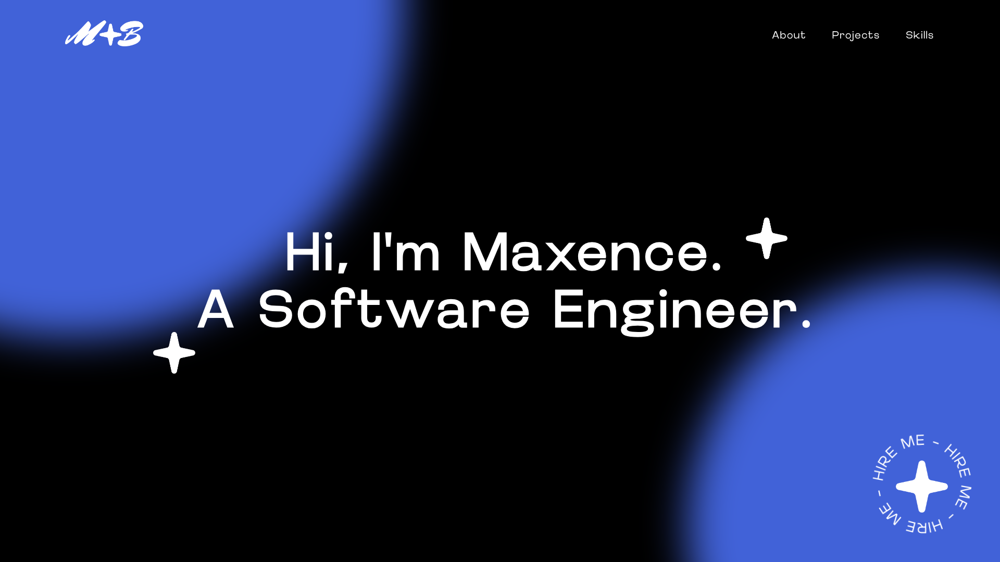

# Portfolio v3

Personal portfolio of Maxence Bonamy.

Single-page website presenting the author and a list of projects, each with an autoplaying video preview and the technologies it uses. This is the third version of the portfolio, it is not finished and is not hosted anywhere.



## Table of contents

- [Portfolio v3](#portfolio-v3)
	- [Table of contents](#table-of-contents)
	- [How it works](#how-it-works)
	- [Tech stack](#tech-stack)
	- [Repository structure](#repository-structure)
	- [Prerequisites](#prerequisites)
	- [Installation](#installation)
	- [Running locally](#running-locally)
	- [Useful scripts](#useful-scripts)
	- [Tests and quality](#tests-and-quality)
	- [License](#license)

## How it works

1. **Layout**: `src/App.js` renders five sections one after the other (Home, About, Projects, Skills, Footer), plus a navigation bar and a call to action. Blurred circles are placed in the background from the window size.
2. **Home**: shows the title and the logo. The navigation bar links to the About, Projects and Skills sections, and retracts as soon as the page is scrolled.
3. **Projects**: `src/Sections/Projects/Projects.json` lists 15 projects (name, description, technologies, video, type, GitHub and demo links). Each one is rendered by the `Project` component with a looping muted video.
4. **Interaction**: project cards use `vanilla-tilt` for a tilt effect. The "Hire me" button is a curved text drawn with `react-curved-text`.
5. **Work in progress**: the Skills and Footer sections are empty and the layout is not responsive yet.

## Tech stack

| Layer | Technologies |
| --- | --- |
| Pages | React 18, Create React App (`react-scripts` 5) |
| Styles | SCSS compiled to CSS next to each source file |
| Libraries | `vanilla-tilt`, `react-vanilla-tilt`, `react-curved-text`, `react-full-height` |
| Tests | Jest and React Testing Library |
| Assets | WebP images, MP4 previews, local font (`Kanakira`) |

## Repository structure

```
.
├── assets/
│   └── hero.png            README screenshot
├── public/                 HTML template, manifests, robots.txt
├── src/
│   ├── Assets/             Colors, fonts, images and project videos
│   ├── Components/         Navbar, CallToAction, Circle, Project, Tilt
│   ├── Sections/           Home, About, Projects, Skills, Footer
│   ├── App.js              Page composition
│   └── index.js            Entry point
├── package.json
└── LICENSE
```

Each component and section lives in its own folder, with a `.js` file and an `.scss` file of the same name. The `.css` and `.css.map` files next to the SCSS files are compiled output and are committed.

## Prerequisites

- [Node.js](https://nodejs.org/) with npm

## Installation

```bash
git clone git@github.com:maxencebonamy/Portfolio-V3.git
cd Portfolio-V3
npm install
```

## Running locally

```bash
npm start
```

The site is then available at <http://localhost:3000> and reloads on changes.

## Useful scripts

| Command | Effect |
| --- | --- |
| `npm start` | Start the development server |
| `npm run build` | Create a production build in `build/` |
| `npm test` | Run the tests in watch mode |
| `npm run eject` | Eject from Create React App (irreversible) |

## Tests and quality

```bash
npm test
```

Tests run with Jest and React Testing Library. ESLint uses the `react-app` and `react-app/jest` presets and runs during `npm start` and `npm run build`.

## License

This project is licensed under the [MIT License](LICENSE).
